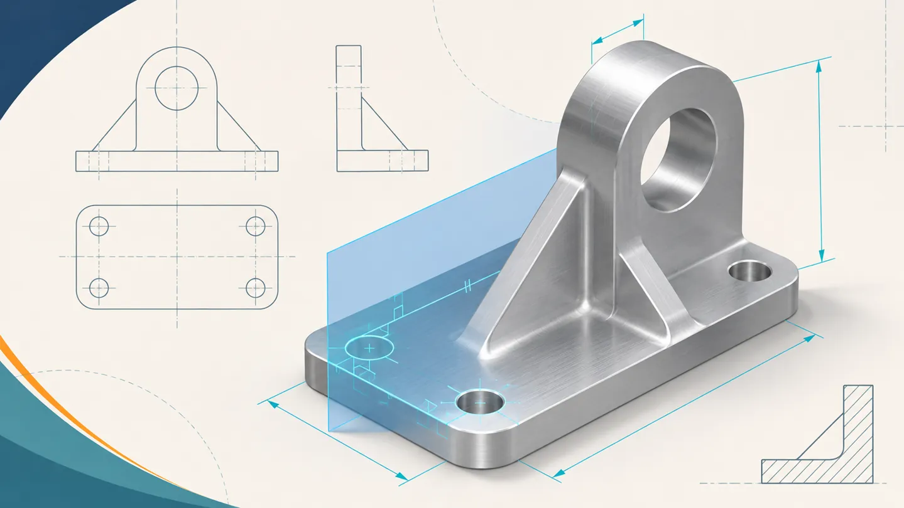
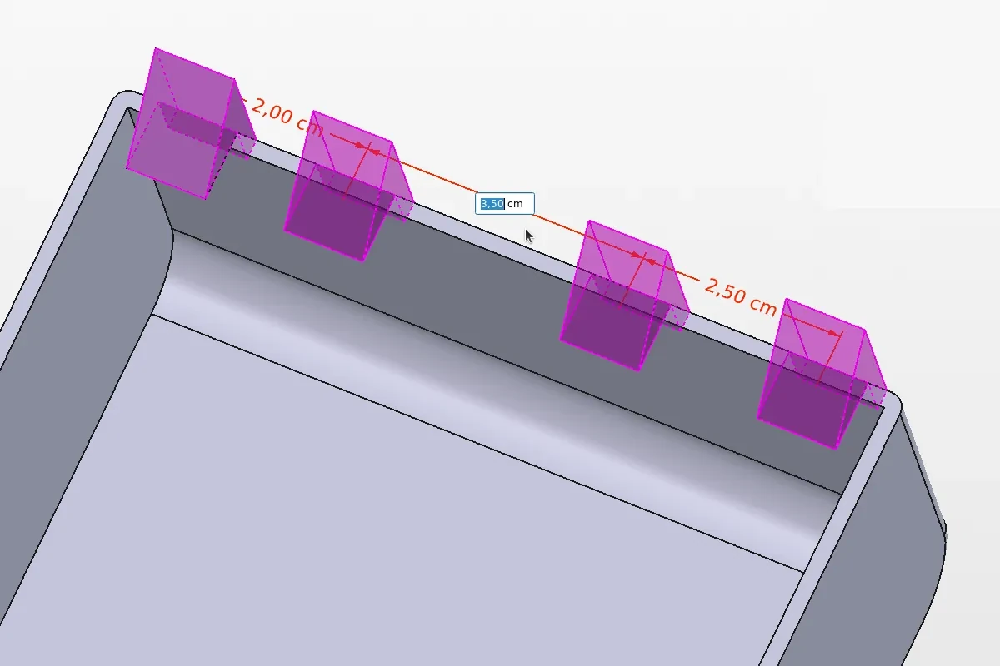
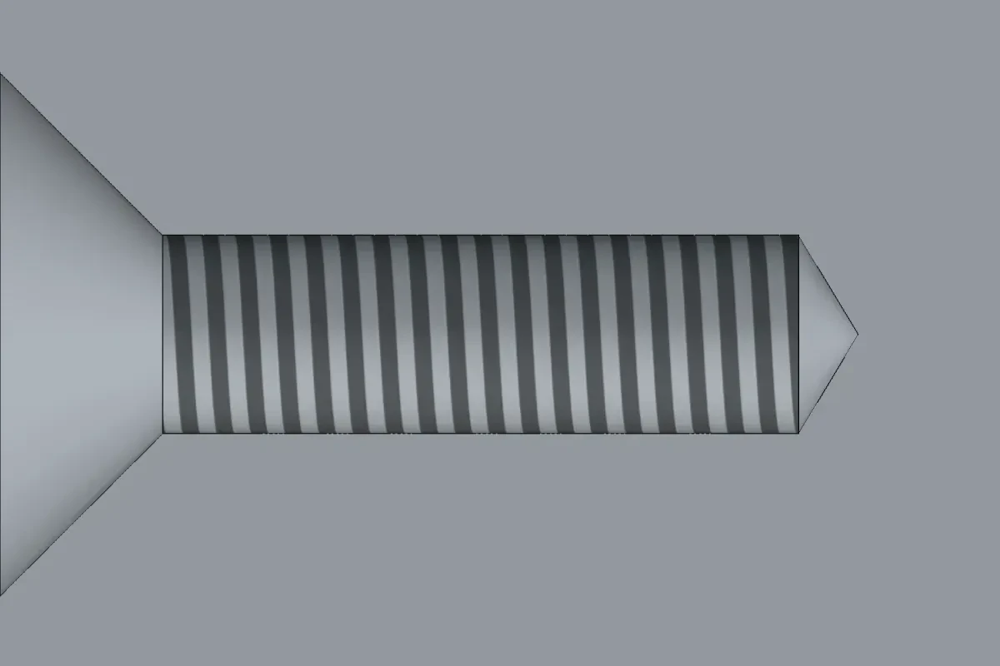
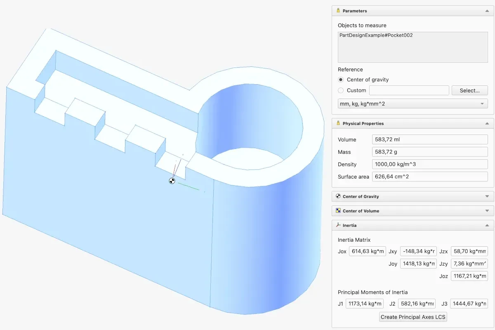
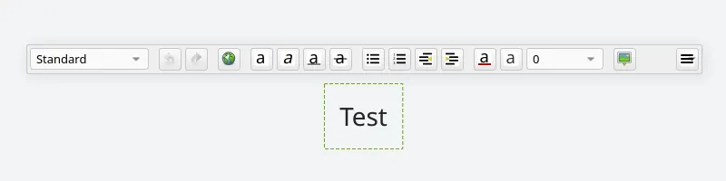

*AI-generated editorial illustration; not a FreeCAD screenshot.*

*From offset pockets and editable hole patterns to mass checks and clearer drawings, here’s what FreeCAD 26.3 changes in a typical design workflow.*

A mounting bracket makes a good test for a CAD upgrade. The mounting face moves, one bolt clashes with a rib, and a weight-saving cut needs to show up on the drawing. In FreeCAD 26.3, you can keep the old and revised sketches open side by side, change where a pocket starts, and turn off a single hole in a pattern directly from the 3D view. Those are small changes individually. On a part that goes through several revisions, they can save a surprising amount of backtracking.

FreeCAD 26.3 follows 1.1. The project has adopted calendar-based versioning and a schedule of three stable releases per year, so **26.3 refers to the third release slot of 2026**. This article covers the features documented during the release candidate cycle. [FreeCAD release schedule](https://github.com/FreeCAD/FreeCAD/discussions/32821) · [Current release builds](https://github.com/FreeCAD/FreeCAD/releases)

## 1. Keep the old design open while editing the new one

FreeCAD 26.3 lets multiple documents keep active editing tasks, each with its own undo and redo history. If you’re moving a mounting point to match a revised enclosure, you can leave the enclosure sketch open, switch to the bracket file, and edit its sketch there. You can go back to check a dimension without first closing the sketch you’re working on.

Recomputation also moves into the background and becomes more fine-grained. If you maintain a model with a long feature tree, try changing a dimension near the top of that tree and see how the interface behaves while the dependent features update.

One smaller improvement is easy to appreciate when you need it. **File → Open** now accepts `.FCBak` backups directly. Saving an opened backup brings up **Save As**, so you can give the recovered design a new filename. [Multi-document editing](https://github.com/FreeCAD/FreeCAD/pull/21978) · [Release notes mirror](https://reqrefusion.github.io/FreeCAD-Documentation-html/wiki/Release_notes_26.3.html) · [Opening backup files](https://github.com/FreeCAD/FreeCAD/pull/28454)

## 2. Put the dimension on the reference you actually use

Say the position of a slot depends on the edge of a shoulder already modeled in the part. While editing the slot sketch, you can now select that model edge directly with a supported Sketcher dimension or constraint tool. FreeCAD creates the projected external reference as part of the operation. That saves the separate step of adding external geometry before placing the constraint. [Sketcher external references](https://github.com/FreeCAD/FreeCAD/pull/31916)

Once the profile is ready, **Pad** and **Pocket** can start at a specified distance from the sketch plane or use a face, plane, or sketch as a starting reference. A pocket that starts at a stepped surface can keep its profile on the main layout plane. If the step height should drive the pocket’s starting position, use the surface as a reference. If the distance itself is the design requirement, enter an offset. The **Hole** tool gains similar start controls, and **Revolution** and **Groove** gain angular start controls. [Pad and Pocket start offsets](https://github.com/FreeCAD/FreeCAD/pull/31688) · [Hole start controls](https://github.com/FreeCAD/FreeCAD/pull/31852) · [Angular start controls](https://github.com/FreeCAD/FreeCAD/pull/32121)

## 3. Lay out a hole pattern, then remove the one that clashes

*Figure 1. Part Design pattern controls in the 3D view. [FreeCAD 26.3 release preview](https://freecad.github.io/Website/download/releases/26-3/)*

Part Design adds three ways to place repeated features. **Circular Pattern** spaces instances around one or more concentric circles. **Path Pattern** follows a curve or edge. **Point Pattern** uses selected points, which is useful when bolt locations follow an irregular layout.

The change I’d look for first on an existing model is **instance suppression**. Suppose a row of holes is evenly spaced except where a reinforcing rib occupies one position. You can suppress that instance from the 3D view and keep the spacing of the rest of the row. The same control is available for existing Mirror, Linear, and Polar patterns. [Part Design pattern changes](https://github.com/FreeCAD/FreeCAD/pull/30840)

If the holes are tapped, the **Hole** tool can display a cosmetic thread. Enable **Threaded** and **Cosmetic Thread**, with **Model Thread** off. The texture makes the threaded holes recognizable in the model. For a part that needs a printable thread profile, use modeled thread geometry. [Cosmetic thread implementation](https://github.com/FreeCAD/FreeCAD/pull/22573)

*Figure 2. Cosmetic thread textures on holes. [FreeCAD 26.3 release preview](https://freecad.github.io/Website/download/releases/26-3/)*

## 4. Check what a cut does to weight and balance

*Figure 3. Mass Properties displays physical measurements alongside the model. [FreeCAD 26.3 release preview](https://freecad.github.io/Website/download/releases/26-3/)*

The new **Mass Properties** command reports volume, surface area, mass, center of gravity, center of volume, and inertia for parts and assemblies. It also supports a custom reference frame.

For a bracket with an off-center lightening pocket, compare the original and revised solids using the same material. The mass tells you how much material you saved. The center of gravity tells you whether the pocket shifted the balance. If the bracket rotates in service, use the same installation coordinate system for both versions so the inertia results are easier to compare. [Mass Properties implementation](https://github.com/FreeCAD/FreeCAD/pull/27347)

## 5. Review an assembly in two positions and clean up its drawing

**Assembly Snapshots** save component placement and visibility. On a hinged enclosure, you could keep a closed state for checking the overall fit and an open state for checking whether a tool can reach the mounting bolts. A **Rigid Group** joint is useful when several components, such as a motor and its adapter plate, need to move together while keeping their positions relative to one another. [Assembly release notes](https://reqrefusion.github.io/FreeCAD-Documentation-html/wiki/Release_notes_26.3.html)

On the drawing side, **TechDraw Screen Mode** changes how edges, vertices, and annotations scale as you zoom. Try it on a crowded detail view where a line or vertex is hard to pick. The context menu now adapts to the selection, and rich-text annotations give longer manufacturing notes some structure. For example, a bold heading can separate the finishing instructions from the rest of the note. [TechDraw release notes](https://reqrefusion.github.io/FreeCAD-Documentation-html/wiki/Release_notes_26.3.html)

*Figure 4. A TechDraw sheet with formatted annotations. [FreeCAD 26.3 release preview](https://freecad.github.io/Website/download/releases/26-3/)*

## What’s new in CAM, BIM, and FEM?

| Workbench | Where the change helps |
|---|---|
| **CAM** | **Indexed 3+2 machining** lets you define an operation on a tilted work plane. The rotary axes position the workpiece or tool for that orientation before the cut. The new machine library and machine-based posting workflow give the postprocessor information about the machine’s axes and limits. |
| **BIM and Draft** | **Report** can query model data for schedules, and **Covering** represents finishes or cladding. In Draft and BIM task panels, typing a coordinate, length, or angle locks that field, so you can move the cursor to set the remaining values without overwriting the one you entered. |
| **FEM** | New **Gmsh** refinements support automatic hexahedral meshing, and the refactored **CalculiX** solver is now the default. A known analysis is a useful first comparison because you already have a mesh and results to check against. |

[FreeCAD release coordination](https://github.com/FreeCAD/Assets/issues/12) · [Full release notes mirror](https://reqrefusion.github.io/FreeCAD-Documentation-html/wiki/Release_notes_26.3.html)

## Try it on a model you already know

Start with a copy of a part that has a sketch, a repeated feature, and a finished drawing. Change an upstream dimension, suppress one pattern instance, then compare the mass and inspect the drawing. You’ll find out quickly which changes remove steps from your own workflow. If you’re using a release candidate, keep production files in your stable FreeCAD build and use copies for the comparison. [FreeCAD downloads and release candidate notes](https://github.com/FreeCAD/FreeCAD/releases)

## Image credits

Figures 1–4: FreeCAD contributors, [FreeCAD 26.3 release preview](https://freecad.github.io/Website/download/releases/26-3/), [CC BY-SA](https://creativecommons.org/licenses/by-sa/4.0/). Images resized and recompressed for this website. Cover illustration generated with AI for CAD For One.

