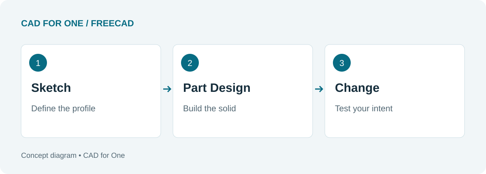
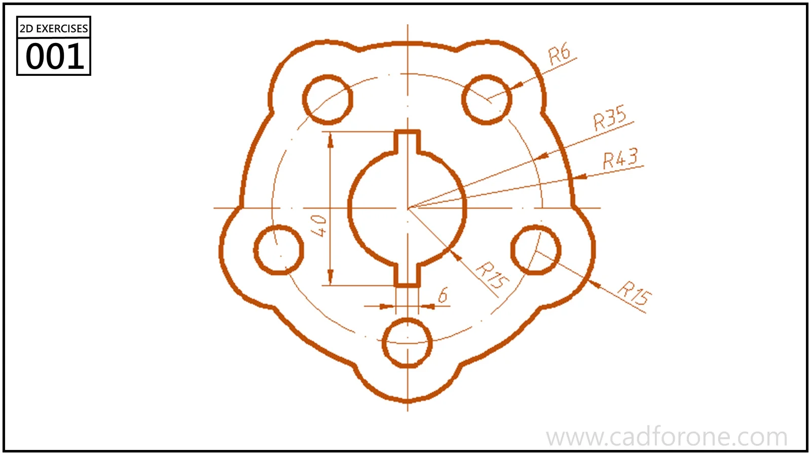

A part can look right and still be awkward to edit. Move a hole, change the width, or increase the thickness, and you find out how much thought went into the model.

That is a useful reason to learn FreeCAD. It is a free, open-source parametric modeler: dimensions and relationships help define a part, rather than leaving you with a shape that merely looks correct. The [FreeCAD project overview](https://www.freecad.org/) explains that approach. For drawing practice, the appeal is straightforward: build a part, change something, and see whether the design still behaves sensibly.

<!--more-->

*An editorial diagram of the learning process, not a FreeCAD screenshot.*

## Start smaller than the part you want to make

A complex casting may be more interesting than a plate, but it also gives you several unfamiliar problems at once. For a first session, pick an outline you can explain without touching the mouse. Identify its centerline, repeated elements, and the dimensions that locate each feature.

The drawing below is useful for that kind of reading exercise. Before trying to finish it, find the central opening and the repeated holes. Decide which relationships you want to preserve if a diameter changes.

*From the CAD for One library. Use it to study the sketch relationships; it is not a completed FreeCAD model.*

[Open the full drawing]().

## Learn a short route through the tools

FreeCAD organizes tools into workbenches. For a first mechanical part, focus on Sketcher and Part Design. Sketcher handles the profile and its constraints; Part Design provides operations such as Pad and Pocket to add and remove material. You do not need to learn the entire workbench menu before making a useful part. See the official [getting-started guide](https://github.com/FreeCAD/FreeCAD-documentation/blob/main/wiki/Getting_started.md) and [Part Design reference](https://github.com/FreeCAD/FreeCAD-documentation/blob/main/wiki/PartDesign_Workbench.md).

Try a deliberately plain sequence: a rectangle, an extrusion, and a hole. Save the document. Then change the rectangle's width. Does the hole stay where you intended, or does it remain at an arbitrary distance from an edge?

That second result is not wasted work. It tells you what your dimensions actually mean.

## What may slow you down

The first obstacle is often deciding which object or sketch should be active. When a command refuses to do what you expect, pause before trying a different toolbar. Check what is selected, which workbench you are in, and what the operation needs as input.

Another trap is adding detail too soon. A rounded edge looks satisfying, but it will not fix an unstable sketch. Leave cosmetic finishing until the main shape survives a simple change.

## A worthwhile first-session goal

Aim to leave with one saved, editable part and a short note about how it was built. A useful note might read: “The hole is centered on the plate; width and thickness can change independently.” That is more informative than a screenshot of a finished shape.

If you are unsure where the workbenches fit, continue with [the Sketcher-to-TechDraw route](). Download the application through the [FreeCAD project's download page](https://www.freecad.org/downloads.php), and match tutorials to the version you install.
