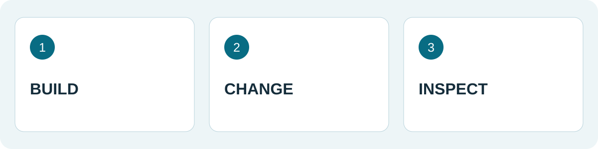
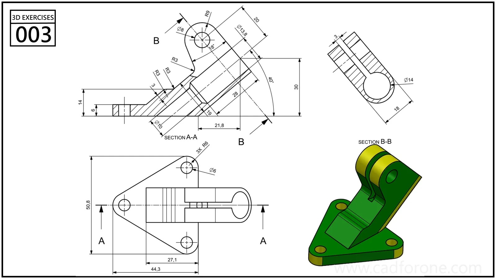

A model can match a drawing beautifully and still be awkward to change. The real test comes when a hole moves, a wall gets thicker, or an early sketch needs another edge.

That is the useful lesson to take from FreeCAD's 1.0 milestone. The version number is history; the question it raised still belongs in every practice session: can the model survive the next edit?

<!--more-->

*An original CAD for One exercise plan, not a software screenshot.*

## Why the milestone mattered

In the [official 1.0 announcement](https://blog.freecad.org/2024/11/19/freecad-version-1-0-released/), published by Jo Hinchliffe on November 19, 2024, the project highlighted topological naming mitigation and a built-in Assembly workbench. The naming work improved resilience when changes affected the geometry referenced by later features. The announcement also made clear that further work remained.

For a learner, this is a reason to practice revisions, rather than assume that a successful first build proves the entire model is sound. This article looks back at that release; it is not a claim that 1.0 is the newest version.

## Make the first revision deliberately small

Choose a part you already understand. Save a baseline copy, then write down one intended change before touching the model. For example: make the body longer while keeping the hole centered.

There are two separate questions to answer. Did the solid recompute? And did the result preserve the relationship you intended? A hole that remains on a face but drifts away from its intended center is still a failed revision for this exercise.

Keep a short record:

| Before editing | After editing |
| --- | --- |
| What should change? | Did that dimension change? |
| What should stay put? | Did its relationship survive? |
| Which features depend on the edit? | Are those features still correct? |

## Inspect the result from another direction

*Use the separate views as a checking aid. The picture is a practice reference, not a model tested for this article.*

An isometric view is good at making a part look convincing. A front view is often better at revealing a shifted hole. A section can expose a wall that changed in the wrong direction. Use the view that answers the question, rather than the one that makes the part look best.

After the first check, undo the change and try a different one. Keep these experiments separate so you can identify which edit caused a problem. Save the working result under a new name and reopen it before moving on.

## Give the exercise a useful finish

The deliverable is a pair of files and a sentence explaining the revision. That is more informative than a single polished screenshot: it shows what your model was designed to do.

Start with a drawing from the [3D practice library](/drawings/3d/). The revision checklist above is CAD for One's suggested exercise, not a benchmark of a particular FreeCAD release.

*Source: the official FreeCAD 1.0 announcement linked above. This is independent commentary with an original practice exercise, not a reproduction of the release notes.*
