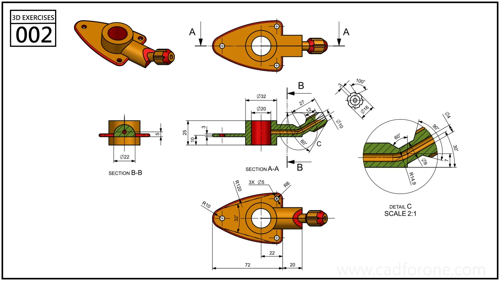

A new CAD build is easiest to judge with a part you already know. An unfamiliar project adds too many questions at once: is the result different because the software changed, because the drawing is difficult, or because you chose another modeling approach?

A small repeatable exercise gives you a better comparison. It also makes your notes more useful if something goes wrong.

<!--more-->

*An original comparison plan. No performance results are implied.*

## What a release candidate is asking you to do

Aleksandr Prokudin's [September 2024 announcement of FreeCAD 1.0 RC1](https://blog.freecad.org/2024/09/10/the-first-release-candidate-of-freecad-1-0-is-out/) invited a broader group of users to try near-complete software on real projects and report problems. The aim was to uncover issues before the final release, not simply celebrate a new download.

That announcement is historical. Its testing idea remains useful, but its download links should not be treated as a recommendation for today's installation. Use the [official download page](https://www.freecad.org/downloads.php) to find current options.

## Start with a copy and a short script

Keep your original file separate. Give the test copy a name that includes the version you intend to use. Write the exercise as a short sequence that another person could follow:

1. Open the copied document and inspect the initial shape.
2. Change one known sketch dimension.
3. Recompute and inspect the affected features.
4. Save to a new file, close it, and reopen it.
5. Compare the result with the original drawing and your intended change.

Do the same operations in the same order. If you change both the modeling strategy and the software, the comparison becomes much harder to interpret.

*Pick a familiar exercise rather than the most complicated drawing in the library.*

## Describe the first wrong result

“The model broke” is an understandable reaction, but it gives someone else very little to work with. A better note separates expectation from observation: “After changing the sketch width, I expected the hole to remain centered. It moved toward the right edge.”

Add the software version, operating system, and the steps needed to reach that point. If a file is necessary, make a small example that contains only the relevant geometry. Check that it really reproduces the problem before sharing it through the project's reporting channel.

Avoid stacking several failures into one report. The first unexpected result is usually the clearest place to begin.

## Decide whether the change matters to your work

A test does not have to cover every workbench to be useful. A person practicing sketch constraints needs a different checklist from someone preparing assemblies. Record what you tried and what you left out, then resist turning a narrow result into a claim about the entire application.

The [2D library](/drawings/2d/) and [3D library](/drawings/3d/) offer repeatable starting points. This is a proposed testing routine, not a hands-on comparison of specific FreeCAD versions.

*Source: FreeCAD's RC1 announcement linked above. The file-handling and reporting checklist is CAD for One's editorial contribution.*
