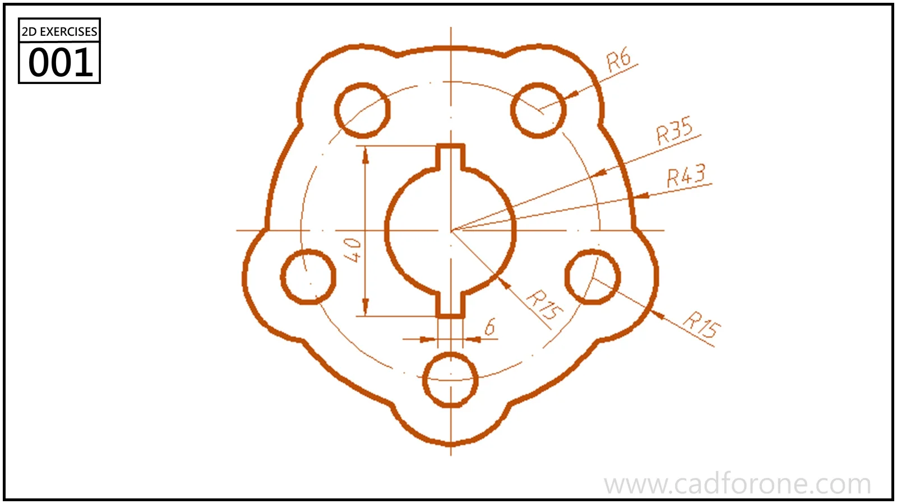

When a drawing already tells you the size of a feature, sketching it approximately and correcting it later can feel like doing the same job twice. FreeCAD's on-view inputs offer another way to work: enter a value while creating the geometry.

The useful distinction is between setting a size and explaining where that geometry belongs. A correctly sized circle can still be in the wrong place.

<!--more-->

*An original sketch-planning diagram, not a FreeCAD interface capture.*

## Read the active input before typing

Jo Hinchliffe's [official on-view parameters tutorial](https://blog.freecad.org/2024/10/20/tutorial-on-view-parameters/), published in October 2024, explains inputs introduced for the 1.0 workflow. For a rectangle, the tutorial steps through width and height using Enter; for a circle, the input sets its diameter. The active field matters: a number has no useful meaning until you know which quantity it controls.

The tutorial also describes Sketcher preferences for dimensional input alone or position plus dimensions. Interface details can vary by release, so treat the original as a version-specific reference rather than assume every current dialog looks identical.

## Try a deliberately plain sketch first

For a warm-up, use an invented rectangle 60 units wide and 40 units high, then add a circle with diameter 12. These are practice values, not dimensions transcribed from the illustration below.

Before drawing, decide what you want the circle to do when the rectangle changes. Should it stay centered? Should it remain a fixed distance from an edge? Those produce different designs, even when the initial picture happens to look the same.

Enter the sizes, then inspect position separately. Do not add a second dimension merely because the sketch looks unfinished; first check which relationships are already present and which still need to be defined.

## Use a change to expose an assumption

Increase the rectangle width and watch the circle. If you intended it to stay centered, does it? If the answer is no, the problem is in the definition of the relationship, not in the neatness of the original sketch.

*Move to a full drawing after the simple warm-up. Use the dimensions printed on that drawing.*

A useful notebook entry is short: “Width changed; circle remained centered” or “Circle position was independent of rectangle width.” Writing the result forces you to state what the sketch actually controls.

## Speed comes after clarity

On-view entry can reduce the interruption between placing a shape and giving it a size. It cannot decide which relationships express your intent. Spend the saved attention on that decision.

Try one feature from a [2D practice drawing](/drawings/2d/), inspect the resulting constraints, and make one revision before adding more geometry. A small sketch that behaves predictably is a better foundation than a busy one you are reluctant to edit.

*Source: the official tutorial linked above. The warm-up dimensions and revision exercise are original editorial examples; they are not a tested step-by-step software lesson.*
