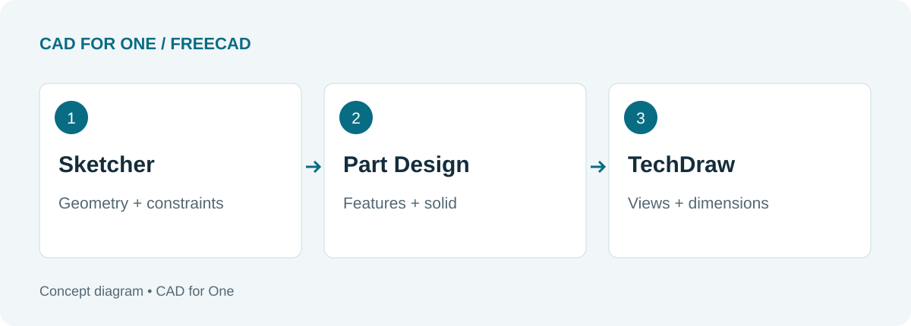
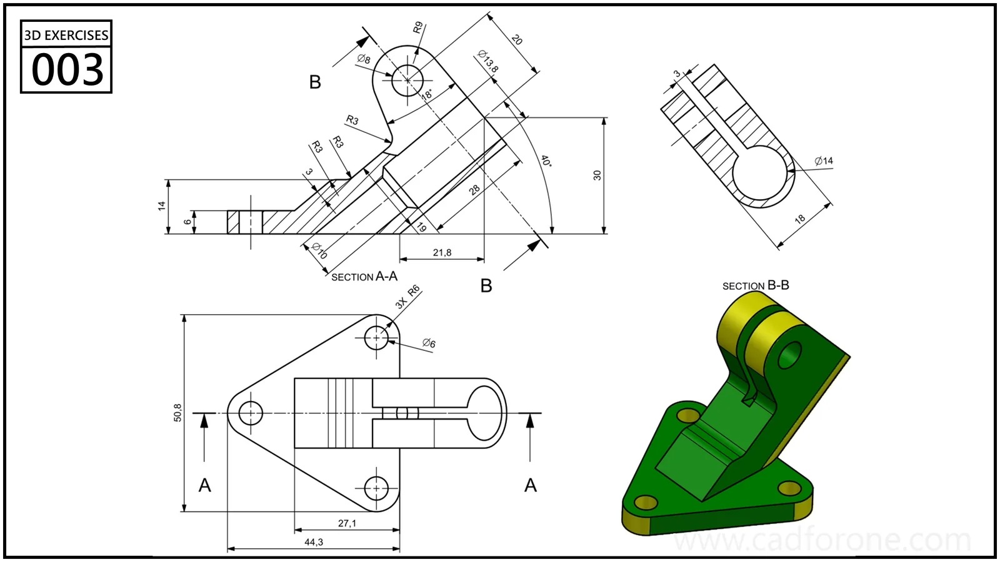

The workbench selector is one of the first things a new FreeCAD user notices. It can also make a modest task feel larger than it is. You want to model one part, yet the application offers tools for many different kinds of work.

For a drawing-based mechanical exercise, three names provide a useful route: Sketcher, Part Design, and TechDraw. Each answers a different question. What is the profile? How does it become a solid? How will someone read the finished design?

<!--more-->

*These are stages of work, not three separate versions of the same drawing.*

## Sketcher: decide what must stay true

A sketch contains geometry, but its relationships matter just as much. Two lines can look parallel without being constrained to remain parallel. A circle can appear centered without having a relationship that keeps it there.

FreeCAD's [Sketcher documentation](https://github.com/FreeCAD/FreeCAD-documentation/blob/main/wiki/Sketcher_Workbench.md) describes geometric and dimensional constraints. Think of them as a way to record design intent: equal radii, a shared center, a tangent connection, or a specified distance.

For practice, draw a rectangle around the origin. Give it a width and height. Then ask whether it can still move. The shape's size and its position are separate questions; fixing one does not automatically settle the other.

Avoid using a fixed constraint simply to make the solver stop asking questions. First work out which relationship is missing.

## Part Design: build a readable sequence

Part Design builds features within a Body. A Pad adds material from a profile; a Pocket removes it. Its [official reference](https://github.com/FreeCAD/FreeCAD-documentation/blob/main/wiki/PartDesign_Workbench.md) covers these and the other available features.

Try to make the sequence understandable to your future self. Separate the main volume from a cut that serves a different purpose. Use names that tell you what changed, such as “mounting holes,” rather than expecting to remember every numbered feature.

*Multiple views help you distinguish the main volume from secondary features. This is a practice reference, not a FreeCAD-generated result.*

[Inspect the complete exercise](). Before modeling it, write down a possible feature order. If that order becomes complicated, try a simpler approach on paper first.

## TechDraw: communicate the result

TechDraw creates drawing pages containing views of model geometry and provides dimensioning and annotation tools. The [TechDraw reference](https://github.com/FreeCAD/FreeCAD-documentation/blob/main/wiki/TechDraw_Workbench.md) is the place to check supported view and dimension tools.

A shaded isometric view helps a reader recognize the part. It does not answer every manufacturing or inspection question. Choose views that expose the features you need to describe, then check whether the dimensions explain size and location without forcing the reader to guess.

For a first exercise, one clean page is enough. Resist the temptation to fill every spare corner with another view.

## A small test that connects all three

Build a plate with a hole, create a drawing of it, and save the document. Change one dimension in the original sketch, recompute, and inspect both the part and its drawing. Check the hole position as carefully as the outside dimensions.

The point is to follow the information from sketch to solid to drawing. Once that route makes sense, the workbench selector becomes less mysterious: you are choosing a stage of the job, not starting over.

For a broader starting point, read [FreeCAD for Drawing Practice]().
