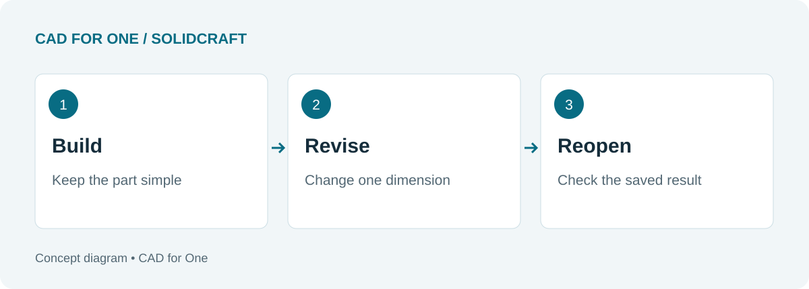
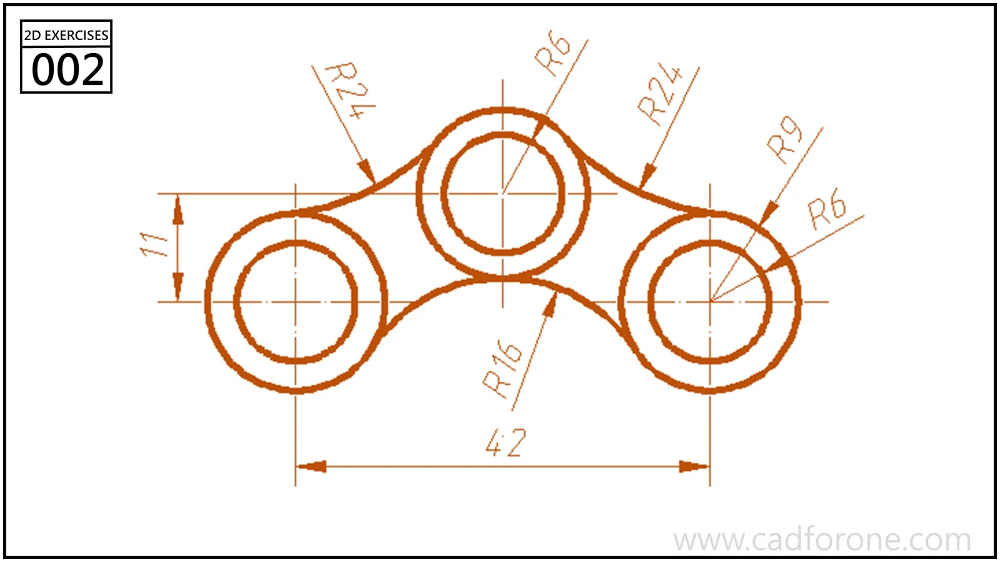

A complicated model is a poor first test of unfamiliar CAD software. If something goes wrong, you have too many possible explanations: the sketch, the selected edge, the feature order, or your understanding of the tool.

For SolidCraft, start with a small plate and give it a revision. That modest task can tell you more about the workflow than an hour spent copying an elaborate demo. The exercise below is an evaluation plan, not a report of a completed software test.

<!--more-->

*Three checkpoints for your own trial. Record what happens in the version you install.*

## Define the part before opening the software

Use a rectangle with one circular through-hole. Choose dimensions that leave plenty of material around the hole, and decide whether its center should follow the plate center or stay a fixed distance from a particular edge.

Write that decision down. Both arrangements can be valid, but they behave differently when the plate grows. Without an intended behavior, it is difficult to judge whether the revised model is correct.

SolidCraft's [command reference](https://docs.solidcraft.io/dev/features.html) lists sketch dimensions, geometric constraints, Extrude, and Hole among its available tools. Check the current documentation for the exact operation and selection requirements in your build.

## Make one change that should be easy

After building the plate, save a baseline copy. Increase its width while leaving the height unchanged. Inspect the hole location, not just the overall outline.

Then change the thickness. A through-hole should still pass through the part if that is how you defined it. If the result differs from your intention, inspect the feature inputs before deciding whether the problem is in the model or the application.

| Check | What to record |
| --- | --- |
| Width edit | New width and resulting hole location |
| Thickness edit | Whether the intended through-cut remains open |
| Save and reopen | Whether the same geometry and editable history return |
| Export and inspect | Format used, overall size, and visible missing features |

These notes make a second attempt useful. They also give you a much better starting point for a bug report than “the model broke.”

## Add detail only after the revision works

Once the plain plate behaves as intended, add one rounded edge. Repeat the width change and inspect that edge again. Keep the test small enough that you can identify which step changed the outcome.

*The library provides more demanding sketch exercises when you are ready. This drawing is a reference, not the plate used in the test above.*

[View this sketch exercise](), or browse the [3D series]() for a later challenge.

## Treat export as a separate check

Saving an editable design and exporting geometry serve different purposes. Keep the native design so you can revisit its parameters. When you export, reopen the exported file in the application that will receive it and inspect the dimensions and features there.

The [upstream README](https://github.com/tangency-labs/solidcraft) identifies `.sc` as the current design format and lists supported interchange formats with qualifications. Check the documentation for the particular import or export path you intend to use; do not assume every format preserves the editable timeline.

Your conclusion may be quite narrow: “This build handles the small parts I need, with these settings.” That is a useful result. It is more actionable than declaring any CAD application the winner after a single session.
