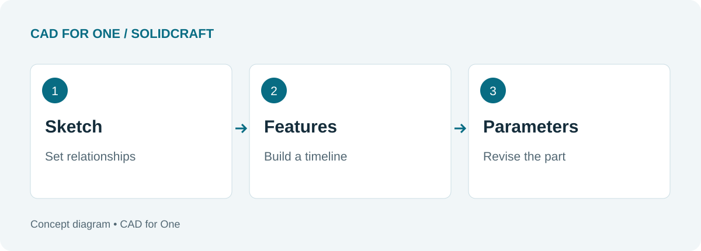
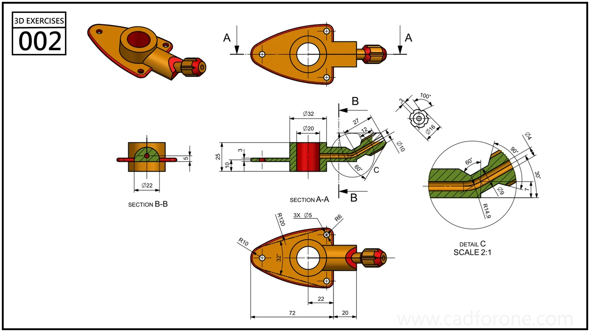

The interesting moment in a CAD demonstration is often the edit near the end. A dimension changes, the part rebuilds, and the features stay where they belong. That is the promise worth examining in SolidCraft.

SolidCraft is an open-source parametric CAD application built in Rust. Its [upstream project](https://github.com/tangency-labs/solidcraft) describes a sketch-and-feature workflow with an editable timeline, plus desktop and browser versions. This introduction is based on the project's documentation, not a hands-on benchmark.

<!--more-->

*An editorial illustration of the parametric workflow; not a screenshot of SolidCraft.*

## The timeline is the important idea

A model is more useful when you can revisit the decisions that produced it. For a simple plate, those decisions might be the outline, its thickness, a hole location, and an edge treatment.

Treat the timeline as a record of those decisions. A change to the outline should have a predictable effect on the later features. The project's [introduction](https://docs.solidcraft.io/) explains how sketches, constraints, and parameter changes feed the rebuild process.

That is also a good way to approach your first exercise. Do not ask only whether you can make the shape. Ask whether you can make it again with one dimension changed.

## Familiar operations, a newer toolchain

The published [feature reference](https://docs.solidcraft.io/dev/features.html) lists operations such as Extrude, Revolve, Fillet, and Shell, along with sketch constraints. These are familiar ingredients for mechanical parts. Their presence in a feature list is a starting point for evaluation, not proof that every combination will work on your geometry.

*An example of the kind of drawing you can work toward. It is not a verified SolidCraft tutorial or a claimed SolidCraft output.*

[Open the drawing](). If you already understand its features, choose one manageable portion for an initial trial. If not, begin with a plain plate instead.

## What the automation support changes

SolidCraft exposes commands through a CLI and an MCP server as well as its interactive interface. The upstream README describes those paths as ways to script or drive a design session. For someone repeating a family of parts, that may be more interesting than a long toolbar.

It does not remove the need to understand the drawing. A command can execute exactly as requested and still produce the wrong part if the requested dimensions or relationships were wrong. Learn to inspect the result before automating the repetition.

## Check the release, not just the demo

SolidCraft is developing quickly. Read the [release notes](https://github.com/tangency-labs/solidcraft/releases) for the build you use, especially before opening an important file in a newer version. For example, the v0.29.0 notes explicitly warn that files saved in that release do not open in v0.28.x or earlier.

Keep a working copy of your design and test the export format you actually need. A successful screenshot is not the same thing as a successful handoff to another CAD application.

A useful next step is [the simple-part evaluation exercise](). It gives you a repeatable way to judge the workflow without assuming that a feature list tells the whole story.
