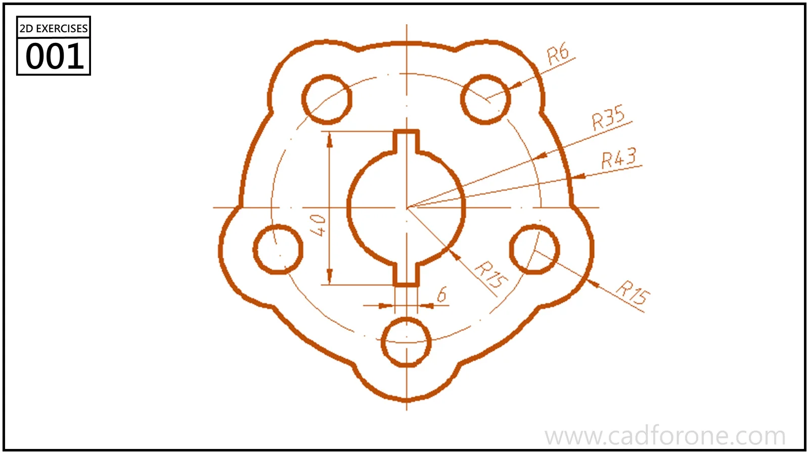

A rounded plate outline with five surrounding holes and a central circular opening interrupted by two narrow notches.

## Drawing reading checks

- Locate the hole centers before constructing the outer arcs.
- Compare the upper and lower notches against the vertical centerline.

## Check your result

- Check each opening against the drawing: its size, center position, and direction must agree across the available views.
