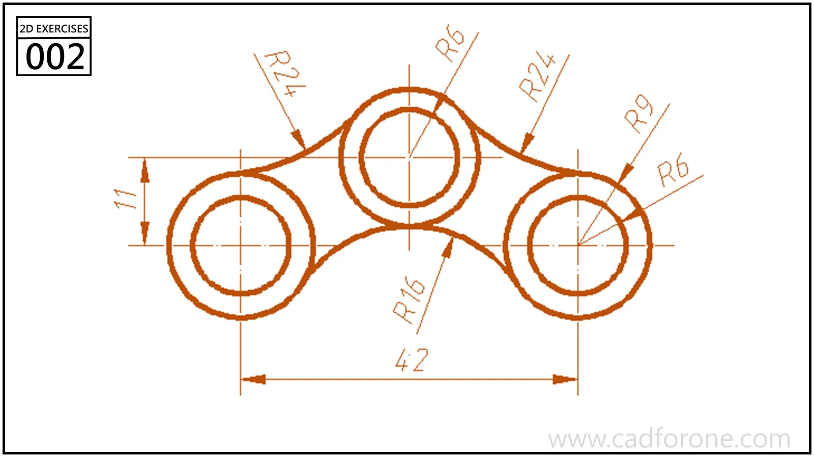

Three circular openings sit in a symmetric outline joined by concave arcs.

Practice notes

- Use the side-hole centerline and raised middle center as construction references.
- Check arc connections and left-to-right symmetry before trimming.

These are suggested reading checks, not a tested modeling tutorial.

