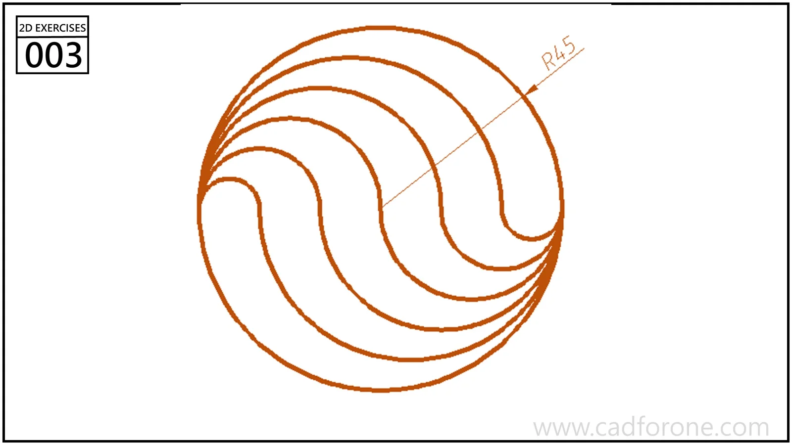

A circular boundary contains nested curved bands that form an S-shaped pattern.

Practice notes

- Separate the outer circle from the internal arc construction.
- Only the outer radius is labeled; record any assumptions needed for the internal curves.

These are suggested reading checks, not a tested modeling tutorial.

