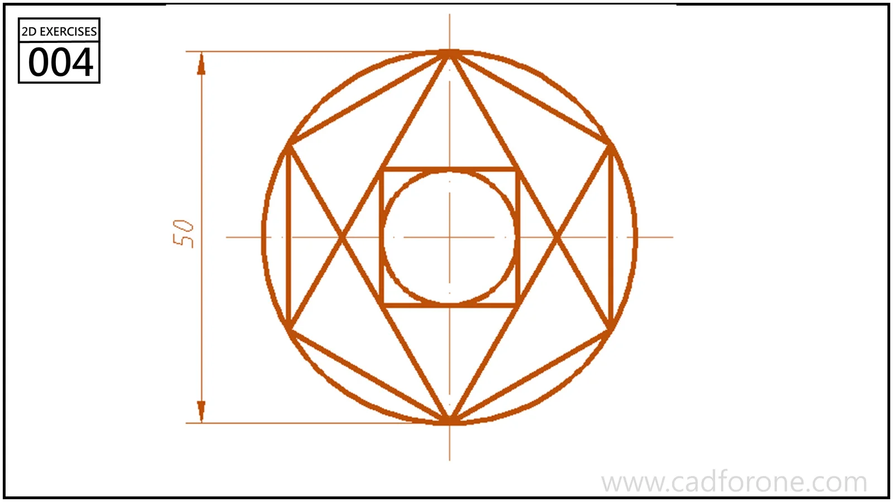

An outer circle encloses intersecting triangles, a central square, and an inner circle.

Practice notes

- Build around the shared horizontal and vertical centerlines.
- Check the intersections before trimming; do not assume an unlabeled length is specified.

These are suggested reading checks, not a tested modeling tutorial.

