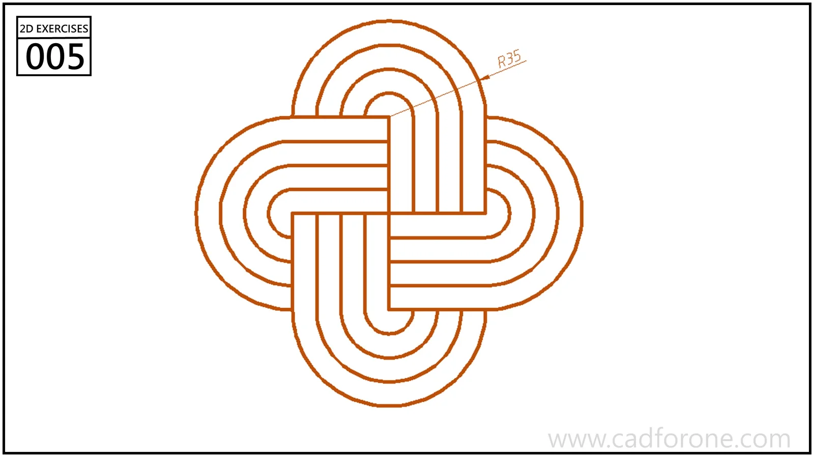

Four rounded loops form an interwoven pattern with repeated parallel bands.

Practice notes

- Construct one loop and study how the pattern repeats around the center.
- Use trimming to express the crossings; note that most internal spacing is not dimensioned.

These are suggested reading checks, not a tested modeling tutorial.

