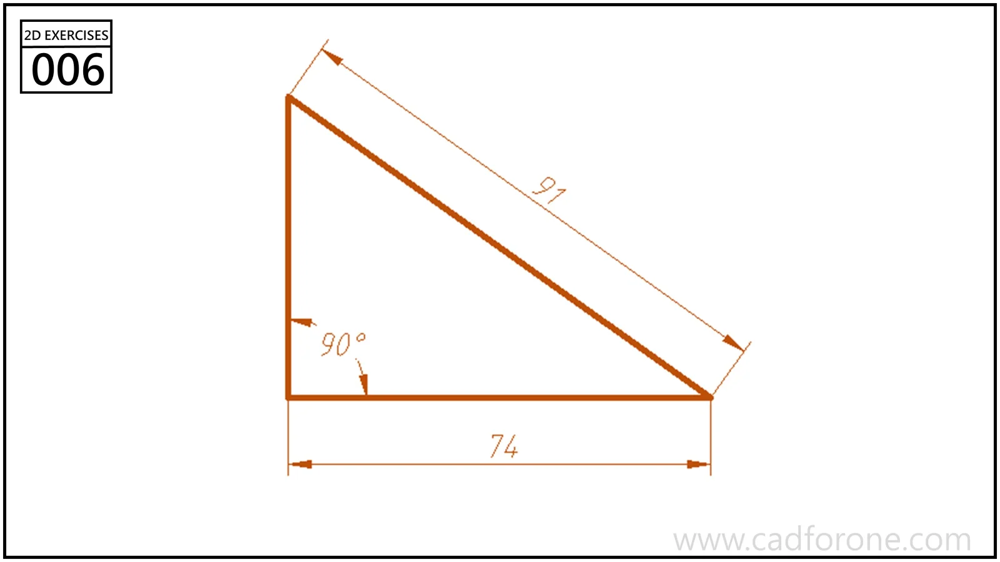

A right triangle with a horizontal base, a vertical side, and a dimensioned hypotenuse.

## Drawing reading checks

- Constrain the base and upright side to be perpendicular.
- Use the given lengths to resolve the third side rather than estimating its angle.
