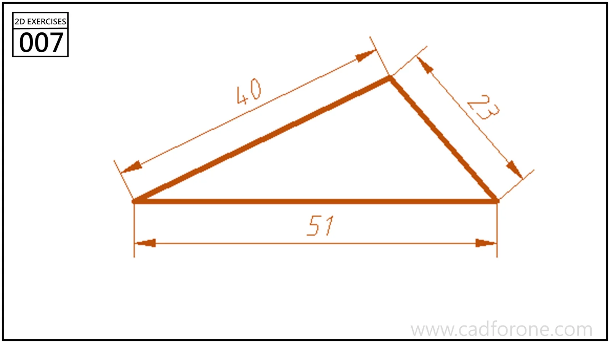

A scalene triangle defined by three side lengths and a horizontal base.

## Drawing reading checks

- Locate the upper vertex from the two distances measured from the base endpoints.
- Check that all three segments meet without leaving a small gap.
