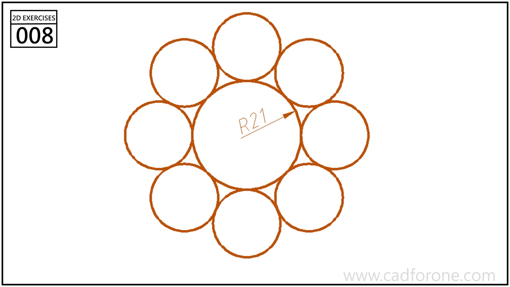

A central circle surrounded by a ring of smaller tangent circles.

## Drawing reading checks

- Establish the center of the arrangement before positioning the surrounding circles.
- Check both the contacts with the middle circle and those between neighboring circles.
