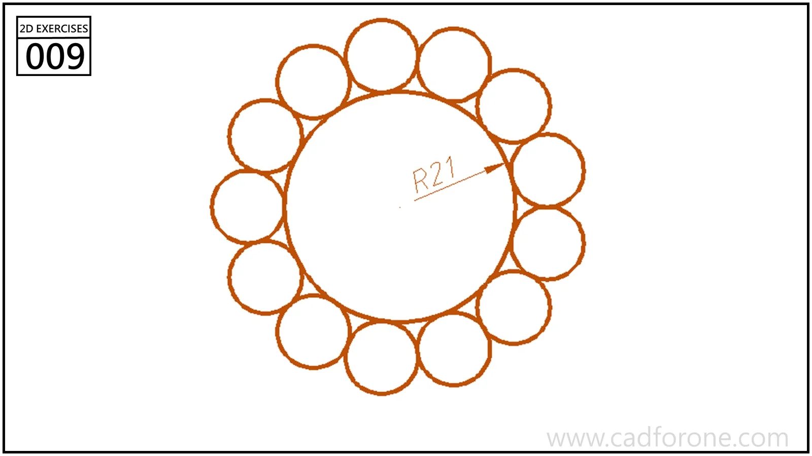

A circular arrangement of twelve small circles around a larger central circle.

## Drawing reading checks

- Distinguish the radius of each small circle from the radius of its center path.
- Check the repeated spacing and tangent contacts around the complete ring.
