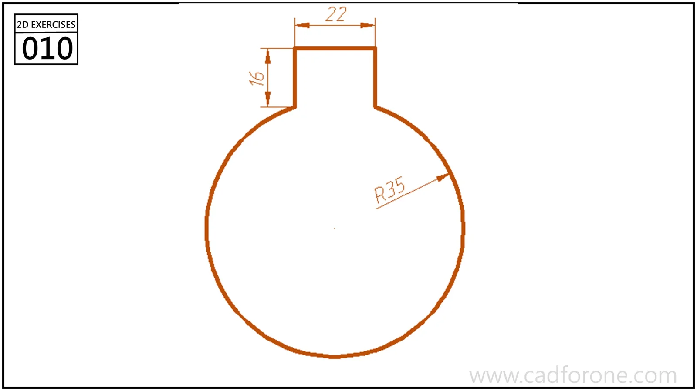

A circular outline extended upward by a narrow rectangular neck.

Practice notes

- Center the neck on the circle before setting its width and height.
- Trim the circle-to-neck junctions to leave one continuous outline.

These are suggested reading checks, not a tested modeling tutorial.

