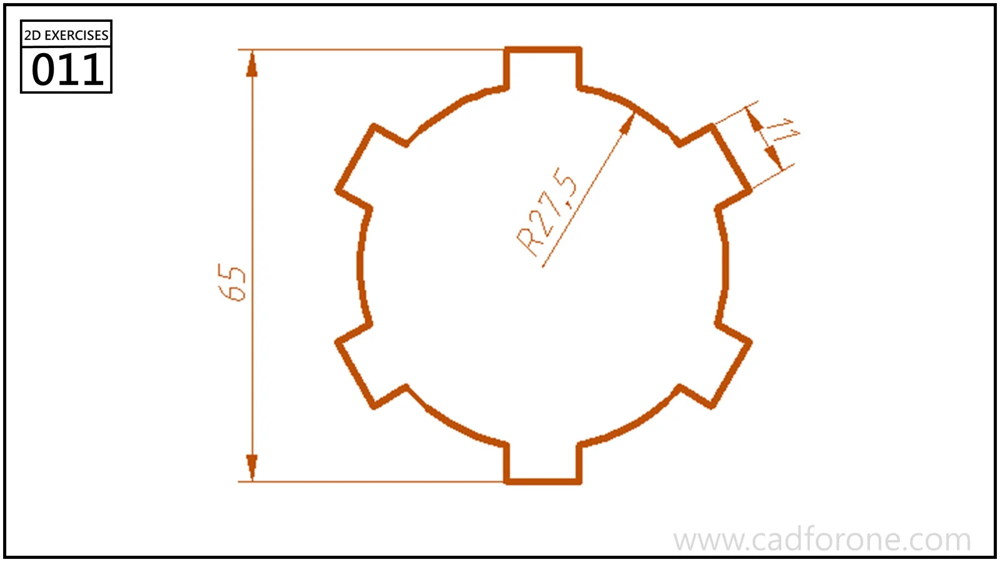

A circular profile with six rectangular tabs extending radially around its edge.

Practice notes

- Build one tab relative to a radial centerline before repeating it.
- Check which dimension describes the circle and which includes the projecting tabs.

These are suggested reading checks, not a tested modeling tutorial.

