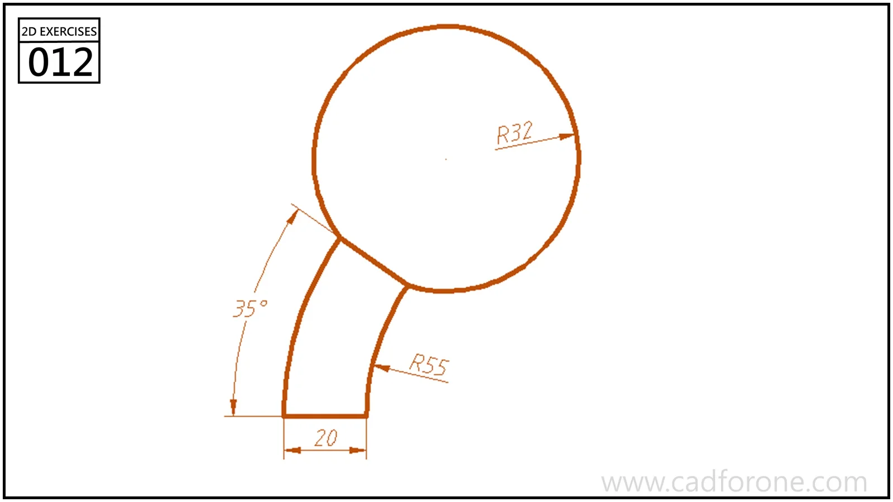

A circular head joined to a curved, narrow stem with a flat lower end.

## Drawing reading checks

- Construct the inner and outer stem arcs from their indicated radii.
- Check how the stem meets the head and where the lower end is trimmed.
