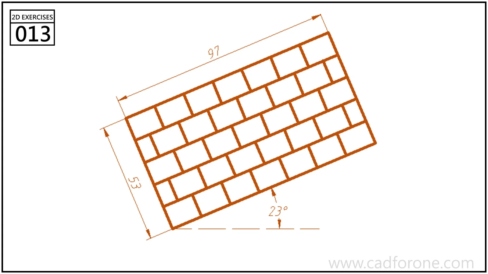

An inclined brickwork pattern made from staggered rows of rectangular blocks.

Practice notes

- Lay out a consistent block and row offset before rotating the pattern.
- Trim the repeated blocks against the specified outer boundary.

These are suggested reading checks, not a tested modeling tutorial.

