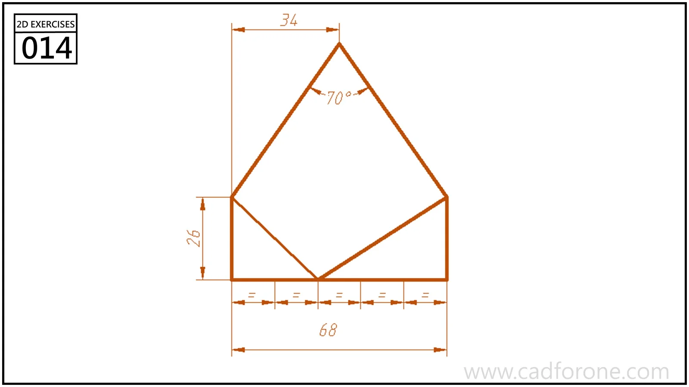

A rectangular outline topped by a triangular roof, with diagonals meeting along the lower edge.

## Drawing reading checks

- Locate the roof apex from the horizontal reference dimensions.
- Use the marked angle and intersections to check the internal diagonals.
