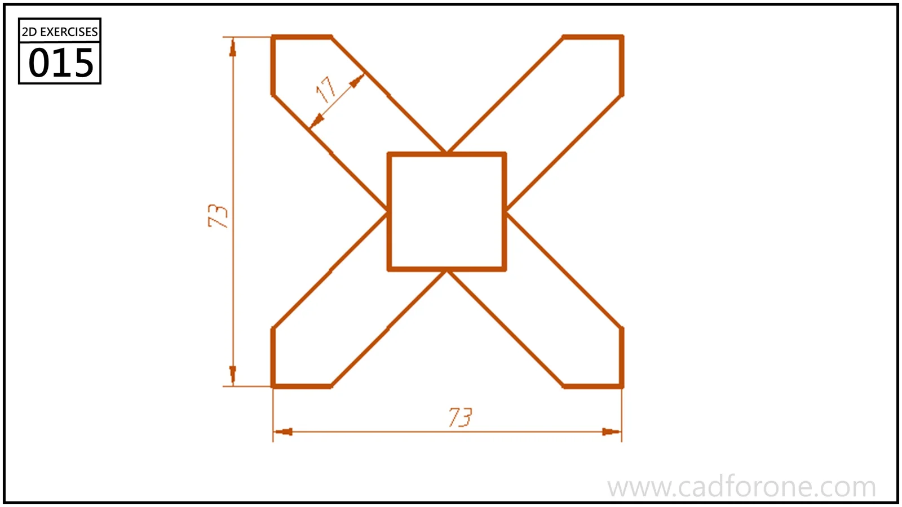

An X-shaped outline with four diagonal arms surrounding a central square.

Practice notes

- Establish the horizontal and vertical centerlines before drawing one arm.
- Check the clipped ends and the intersections around the central square when mirroring.

These are suggested reading checks, not a tested modeling tutorial.

