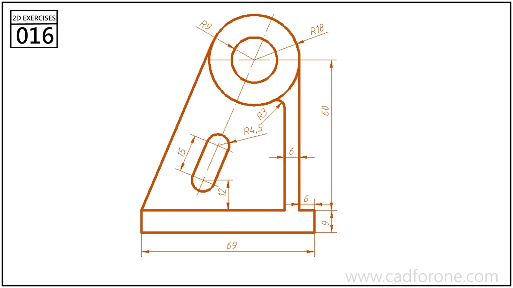

An inclined bracket profile with a circular eye, a rounded slot, and a stepped lower outline.

## Drawing reading checks

- Locate the eye center and the sloping boundaries before adding smaller features.
- Align the rounded slot to its reference direction and check its end radii.

## Check your result

- Check the slot ends and their center positions separately from the surrounding profile; confirm whether each slot is open-ended or enclosed.
