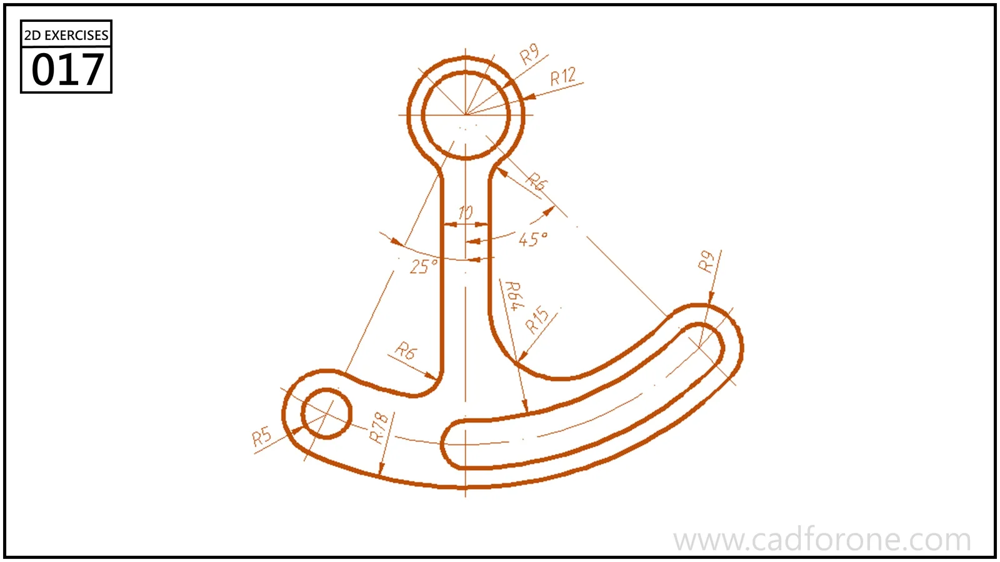

A curved arm with an upright circular eye and a long arcing slot in its lower portion.

Practice notes

- Resolve the centers of the eyes and the curved slot before trimming the outline.
- Check the transition radii where the upright joins the lower arm.

These are suggested reading checks, not a tested modeling tutorial.

