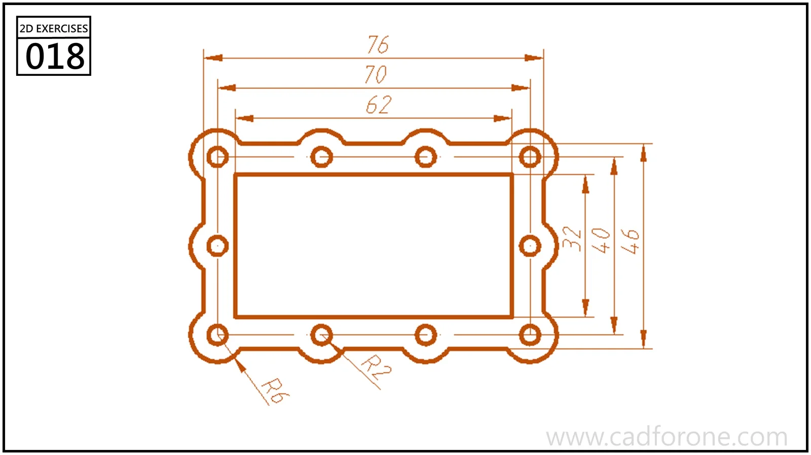

A rectangular frame with a central opening and a scalloped perimeter arranged around mounting holes.

Practice notes

- Lay out the hole centers before constructing the surrounding lobes.
- Check the inner opening independently from the outside envelope.

These are suggested reading checks, not a tested modeling tutorial.

