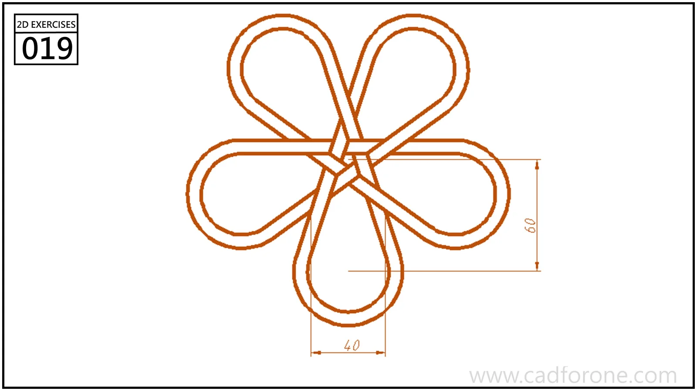

A five-loop rosette with narrow bands crossing near its center.

## Drawing reading checks

- Construct one loop and establish the angular repetition about the center.
- Follow each band through the crossings before trimming overlapping lines.

## Check your result

- Count the repeated elements and check their spacing about the center or along the path; a matching outline alone can hide a misplaced repetition.
