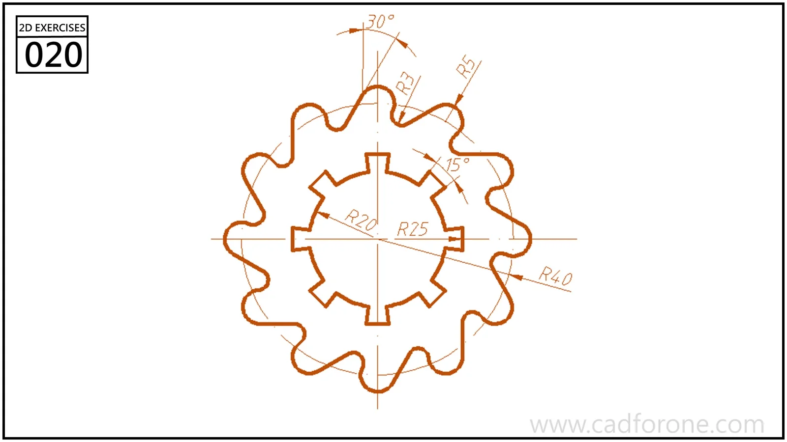

A lobed circular ring with repeated rectangular notches around its inner opening.

## Drawing reading checks

- Build the outer lobes and inner notches as separate repeating features.
- Check the angular spacing and arc radii before joining the final contours.

## Check your result

- Check each opening against the drawing: its size, center position, and direction must agree across the available views.
- Count the repeated elements and check their spacing about the center or along the path; a matching outline alone can hide a misplaced repetition.
