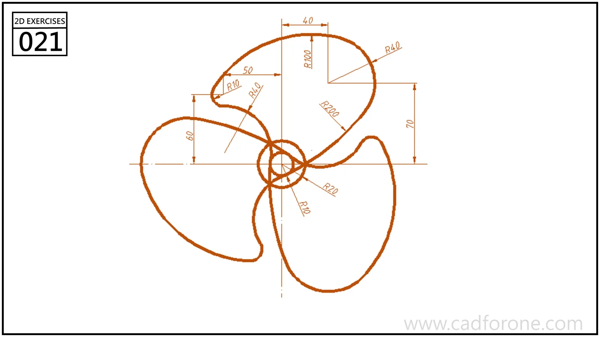

A three-bladed fan outline formed by curved blades around a concentric circular hub.

## Drawing reading checks

- Resolve the arcs of one blade before repeating it around the hub.
- Check the blade-to-hub junctions for the intended continuity.

## Check your result

- Count the repeated elements and check their spacing about the center or along the path; a matching outline alone can hide a misplaced repetition.
