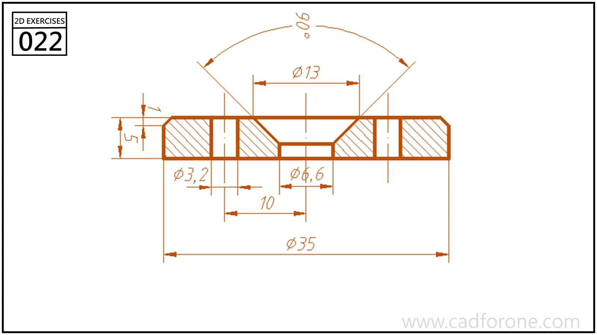

A sectioned circular plate showing a central countersunk opening and smaller straight bores.

Practice notes

- Separate the hatched material from the unhatched openings when reading the section.
- Check the countersink angle and bore size independently from the plate thickness.

These are suggested reading checks, not a tested modeling tutorial.

