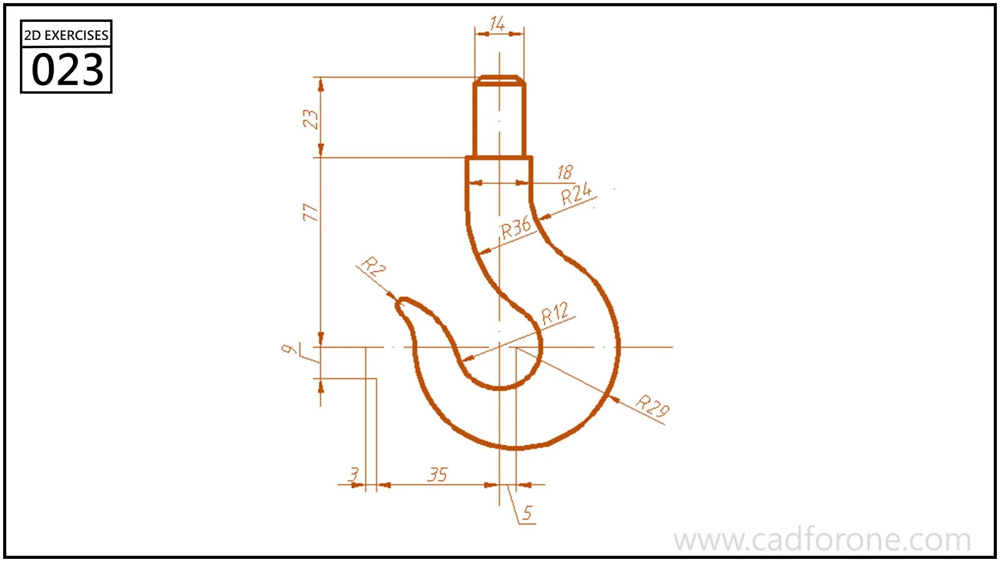

An open hook profile with a straight upper stem and a rounded lower bend.

Practice notes

- Construct the inner and outer bends using their separate radius callouts.
- Check the hook opening and the small transitions into the straight stem.

These are suggested reading checks, not a tested modeling tutorial.

