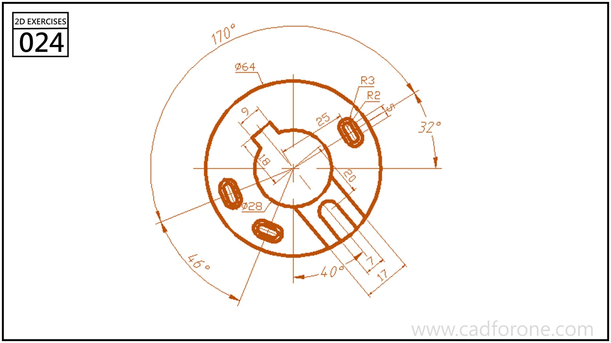

A circular plate outline containing curved slots, a notched center opening, and an open radial slit.

## Drawing reading checks

- Locate the curved slots relative to the central axes before trimming.
- Keep the closed slots distinct from the slit that opens through the outer edge.

## Check your result

- Check each opening against the drawing: its size, center position, and direction must agree across the available views.
- Count the repeated elements and check their spacing about the center or along the path; a matching outline alone can hide a misplaced repetition.
