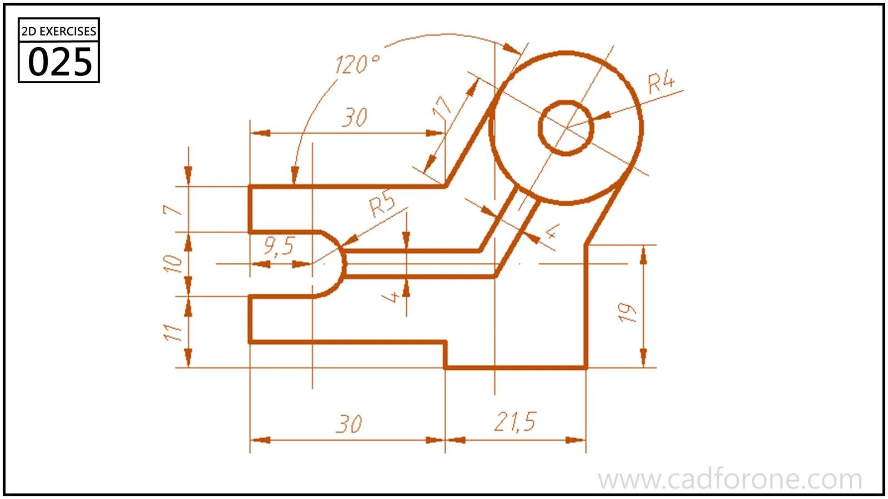

A forked bracket outline with an open slot at one end and an angled arm leading to a circular eye.

## Drawing reading checks

- Locate the eye relative to the horizontal base before drawing the inclined arm.
- Check the rounded end of the open slot and the lower step as separate features.

## Check your result

- Check the slot ends and their center positions separately from the surrounding profile; confirm whether each slot is open-ended or enclosed.
