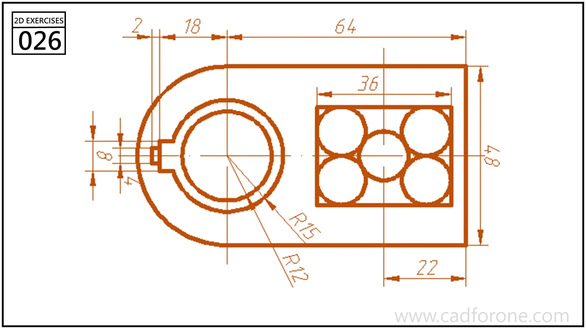

A D-shaped plate outline with a large circular feature on the left and five circles inside a rectangular opening on the right.

Practice notes

- Use the left circular center as a reference for the rounded outer end.
- Position the five-circle arrangement within its rectangle before checking the narrow left-side interruption.

These are suggested reading checks, not a tested modeling tutorial.

