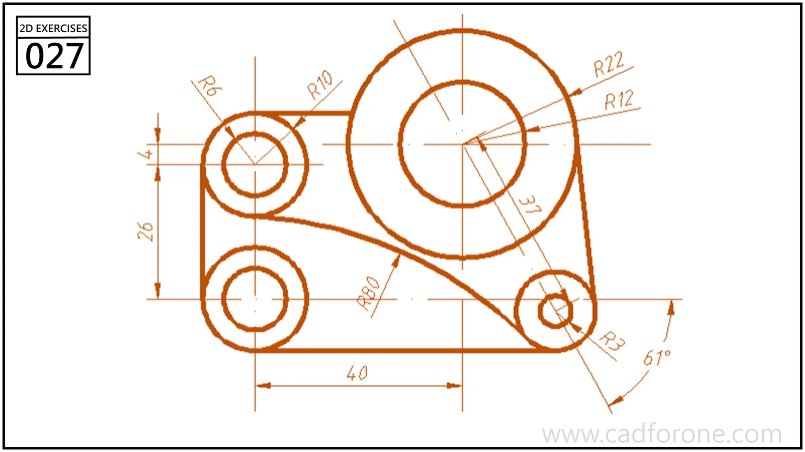

An asymmetric plate outline surrounding one large circle and three smaller circles.

## Drawing reading checks

- Place the circle centers from the reference dimensions before connecting the outside edges.
- Check tangency at each straight-to-curved transition without changing the hole sizes.
