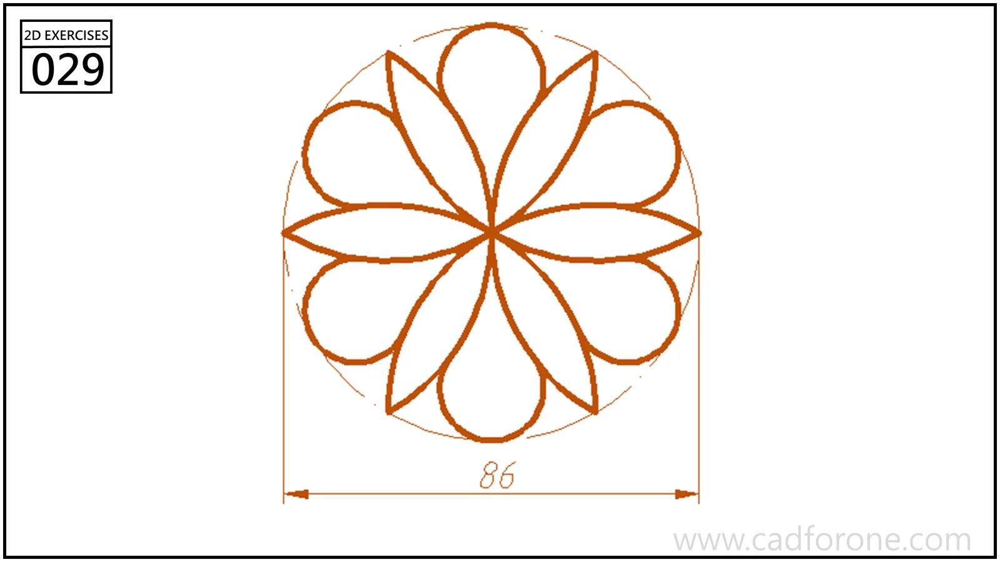

A circular motif combining four pointed leaves with four rounded diagonal lobes.

## Drawing reading checks

- Use the horizontal and vertical axes to organize the repeated elements.
- Check the visible symmetries without treating unmarked internal sizes as specified dimensions.
