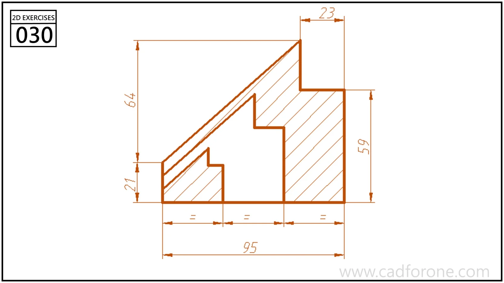

A hatched, sloping profile with stepped recesses rising from its lower edge.

## Drawing reading checks

- Set the base divisions and outer slope before drawing the internal steps.
- Check that the hatch stays within the material boundary and outside the recesses.
