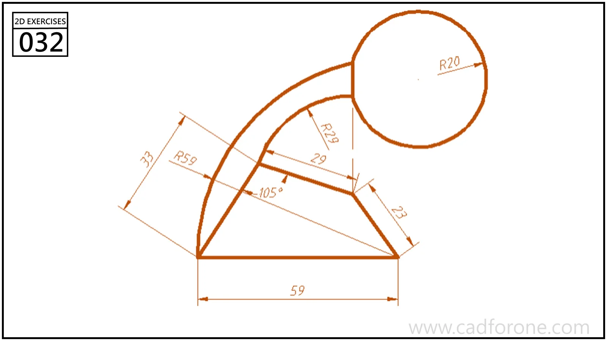

A curved narrow arm rising from an angular base to a circular head.

Practice notes

- Construct the angular base from its lengths and included angle.
- Use the marked arc radii to join the base to the circular head.

These are suggested reading checks, not a tested modeling tutorial.

