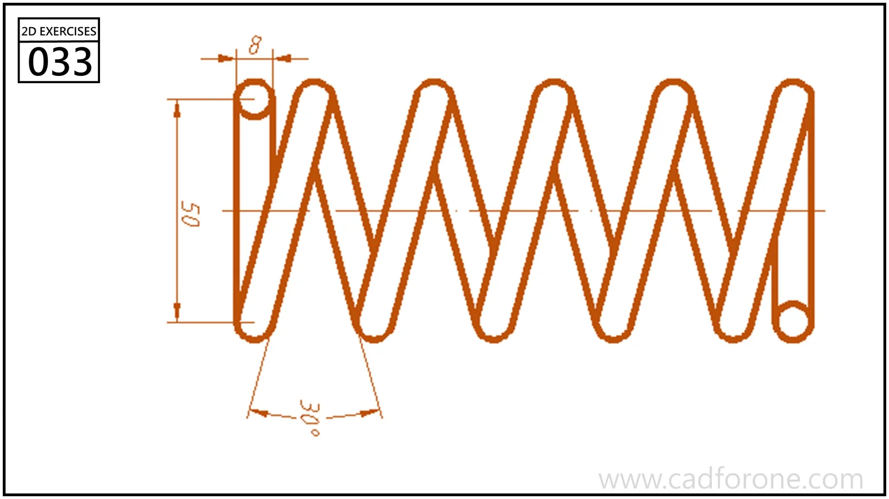

A continuous zigzag band with rounded turns and circular end features.

Practice notes

- Establish the inclination and spacing of the straight runs before rounding their ends.
- Follow both edges through each turn to keep the band width consistent.

These are suggested reading checks, not a tested modeling tutorial.

