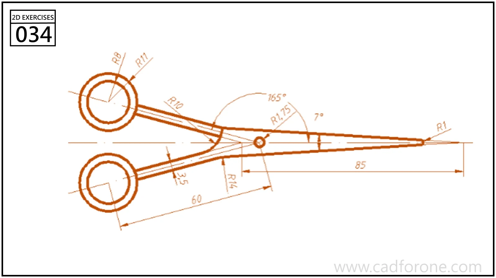

A scissors outline with two circular finger loops, a pivot, and long tapered blades.

Practice notes

- Locate the pivot and finger-loop centers before drawing the blade edges.
- Check the blade angles and the curved transitions into the handles separately.

These are suggested reading checks, not a tested modeling tutorial.

