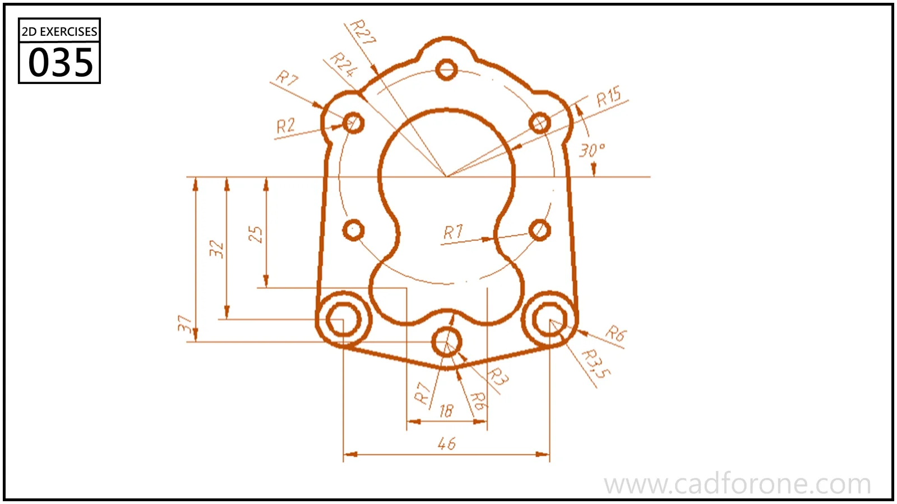

A gasket-like outline with mounting holes, rounded lobes, and an irregular central opening.

## Drawing reading checks

- Lay out the mounting-hole centers and symmetry references first.
- Construct the central opening from its own arcs rather than offsetting the outer edge.

## Check your result

- Check each opening against the drawing: its size, center position, and direction must agree across the available views.
