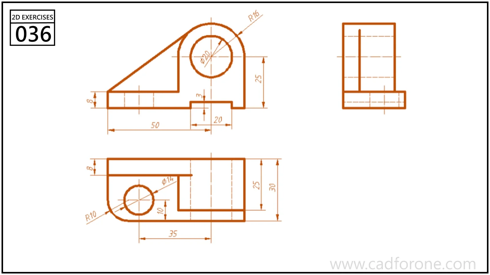

Three orthographic views of a base bracket with an upright circular eye and a sloping support.

Practice notes

- Project the upright eye between the front and side views.
- Use the plan view to check the base outline and mounting-hole position.

These are suggested reading checks, not a tested modeling tutorial.

