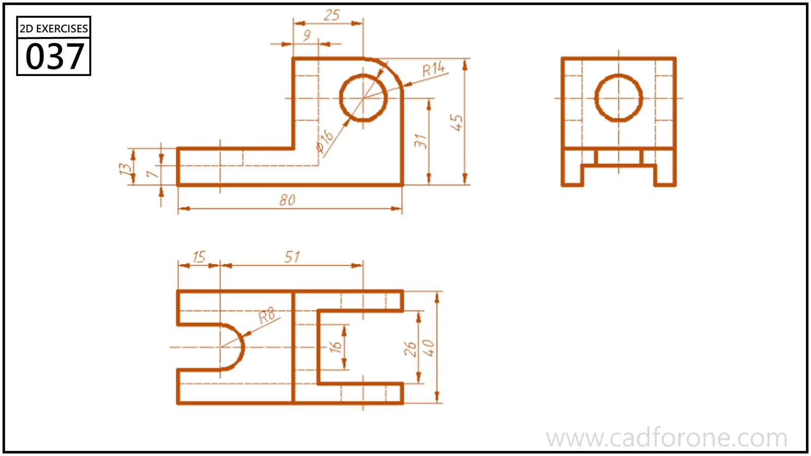

Orthographic views of a bracket with a forked base and a raised, rounded eye.

## Drawing reading checks

- Read the open fork from the plan view before resolving the upright profile.
- Align the eye center and base thickness across the views.
