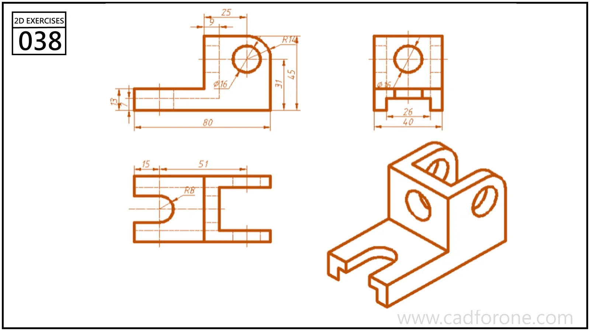

A two-ear bracket shown in orthographic and isometric views, with an open slot in its base.

## Drawing reading checks

- Use the plan view to establish the gap between the upright ears.
- Compare the base slot and ear holes against the isometric view.

## Check your result

- Check the slot ends and their center positions separately from the surrounding profile; confirm whether each slot is open-ended or enclosed.
