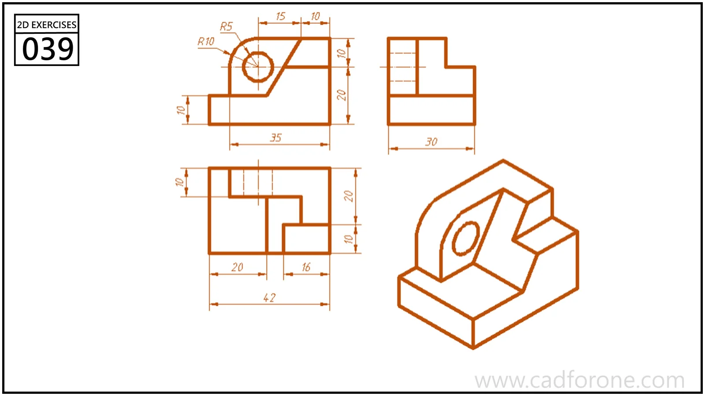

A stepped bracket with a bored upright, an inclined face, and a recessed base.

Practice notes

- Project the hole center through the orthographic views.
- Check which edges belong to the inclined face and which define the lower recess.

These are suggested reading checks, not a tested modeling tutorial.

