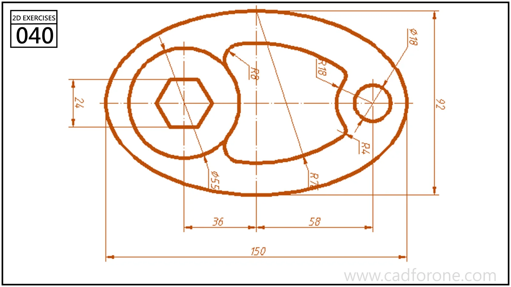

An oval plate outline with a hexagonal opening, a small circular hole, and a curved internal cutout.

## Drawing reading checks

- Locate the two circular centers before constructing the outer oval-like boundary.
- Keep the hexagon and curved cutout as separate closed profiles.

## Check your result

- Check each opening against the drawing: its size, center position, and direction must agree across the available views.
