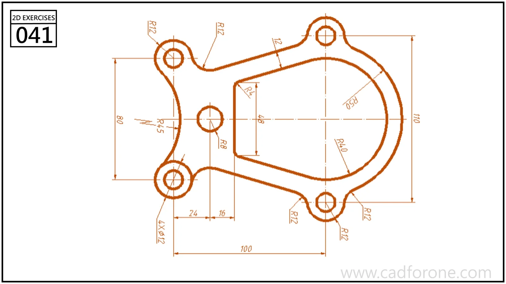

A rounded housing outline with four mounting ears and a large, partly straight-sided opening.

Practice notes

- Position the mounting ears from their center references before adding fillets.
- Check the straight sides and rounded end of the inner opening independently.

These are suggested reading checks, not a tested modeling tutorial.

