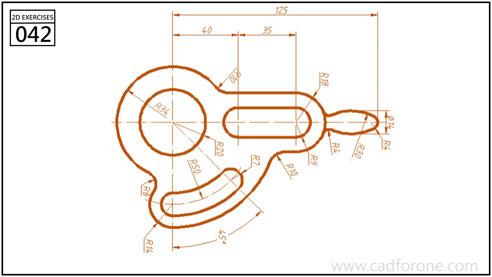

A lever-like outline combining a circular eye, a straight slot, a curved slot, and a small end loop.

## Drawing reading checks

- Place the eye center and straight slot before constructing the lower curved arm.
- Check the different slot centerlines and their end radii without assuming equal widths.

## Check your result

- Check the slot ends and their center positions separately from the surrounding profile; confirm whether each slot is open-ended or enclosed.
