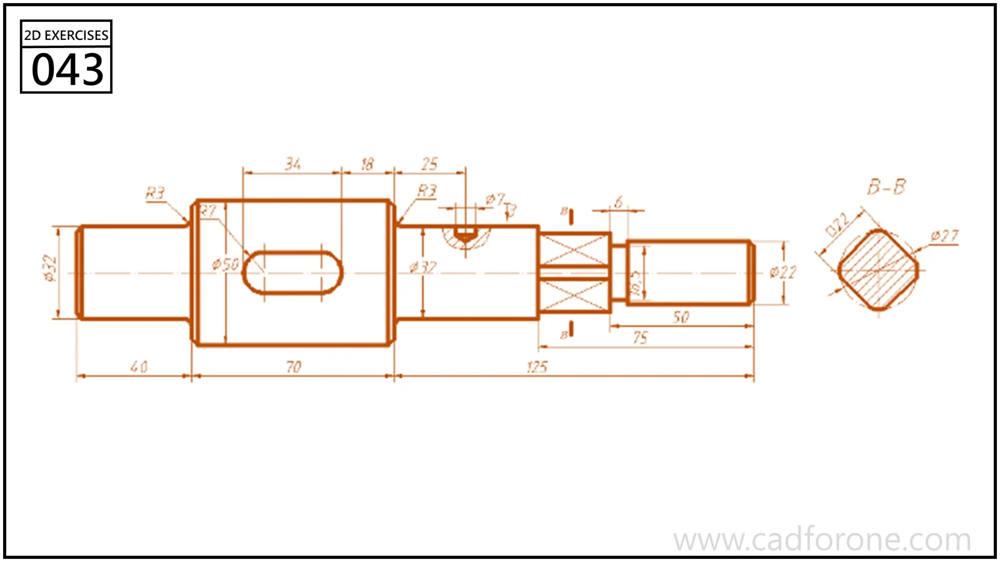

A stepped shaft drawing with a longitudinal slot, a cross-marked section, and an end section view.

## Drawing reading checks

- Read axial lengths separately from the diameter callouts.
- Use the end section to interpret the shaped portion instead of relying on the side silhouette alone.

## Check your result

- Check the slot ends and their center positions separately from the surrounding profile; confirm whether each slot is open-ended or enclosed.
