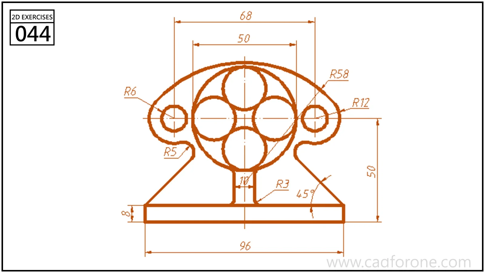

A pedestal-shaped outline with a circular cluster, two side holes, and a sloping base.

## Drawing reading checks

- Establish the vertical centerline and the centers of the inner circles.
- Check the side lobes and the transitions into the angled base.

## Check your result

- Check each opening against the drawing: its size, center position, and direction must agree across the available views.
